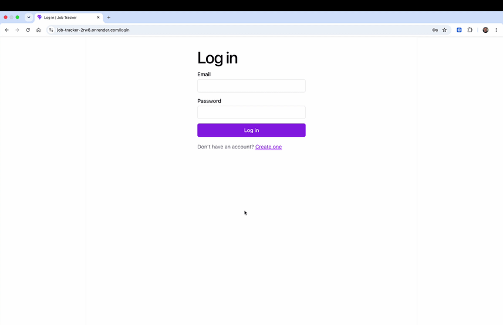
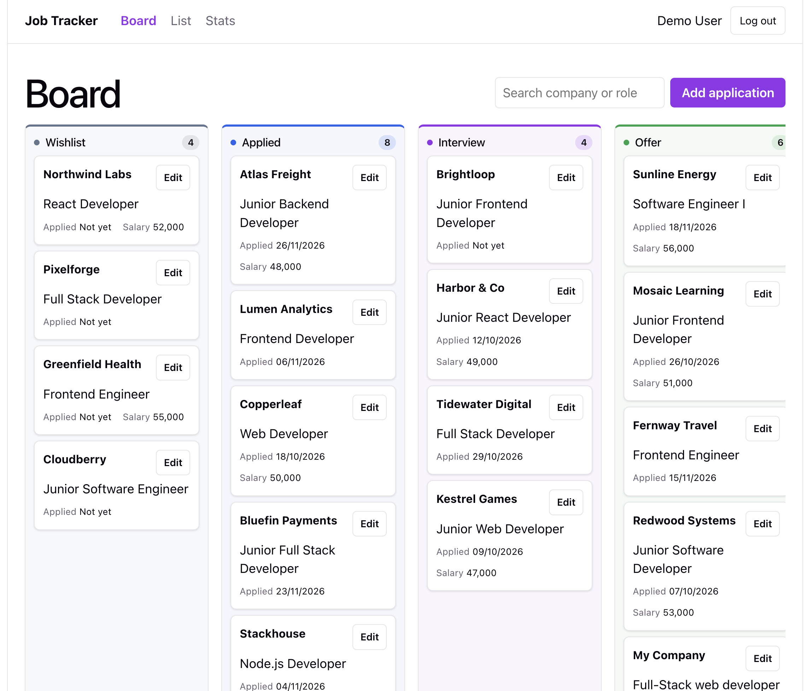
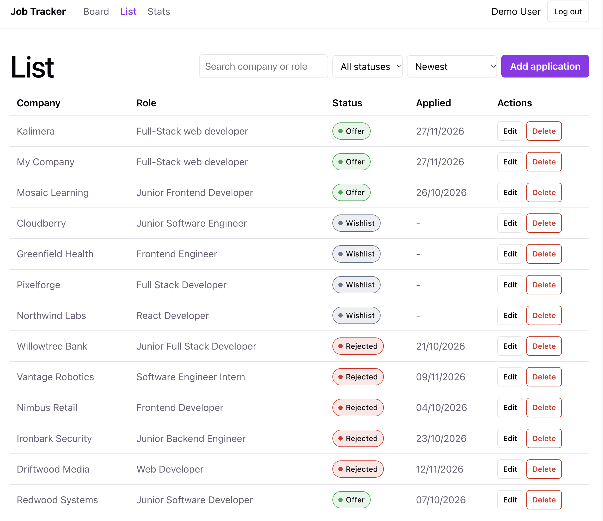
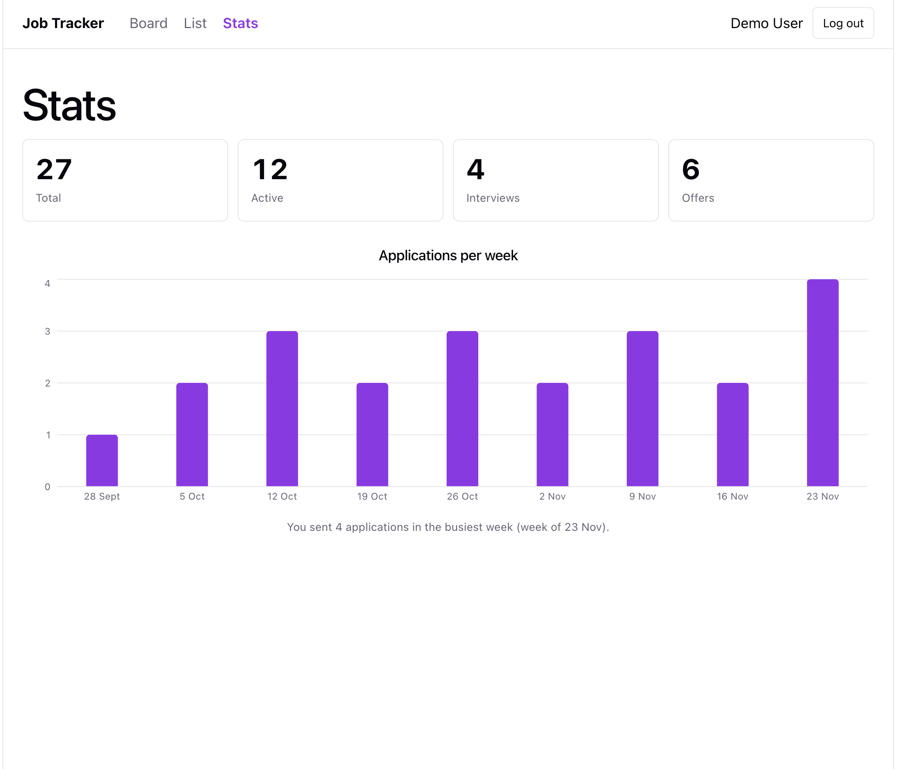

# Job Tracker


Keep track of every job you apply for on a drag-and-drop Kanban board, built with the MERN stack.

## Live demo

**https://job-tracker-2rw6.onrender.com**

Click Try demo to explore with sample data. The free hosting sleeps when idle, so the first load can take up to a minute.



## Features

- Create an account, log in and log out. You only ever see your own applications.
- Add, edit and delete job applications, with company, role, posting link, location, salary, date applied and notes.
- Move applications between Wishlist, Applied, Interview, Offer and Rejected by dragging them with a mouse, touch or the keyboard.
- Open a card to see all its details.
- Search by company or role.
- See everything in a table that you can filter by status and sort. The filters stay in the URL, so a refresh keeps them.
- Check your totals and a chart of applications per week.







## Tech stack

- **Frontend:** React, TypeScript, Vite, React Router, dnd-kit, Recharts
- **Backend:** Node.js, Express, MongoDB with Mongoose, Zod, JWT
- **Testing:** Jest (server), Vitest (client)
- **CI and hosting:** GitHub Actions, Render

## Architecture

The React app talks to a REST API under `/api`; in development, Vite forwards those requests to Express. In production, one Express server provides both the API and the built React files. On the server, a request goes through routes, controllers, services and models: routes pick the handler, controllers validate the input and send the response, and services hold the business rules. Mongoose models describe the data, which is stored in MongoDB Atlas.

```
job-tracker/
├── client/              React + TypeScript app
│   └── src/
│       ├── api/         calls to the REST API
│       ├── components/  shared UI (cards, modals, chart)
│       ├── context/     login state and toast messages
│       ├── hooks/       data loading, debounce, page titles
│       └── pages/       Board, List, Stats, Log in, Register
├── server/              Express API
│   ├── scripts/         seed script for the demo data
│   ├── src/
│   │   ├── routes/
│   │   ├── controllers/
│   │   ├── services/
│   │   ├── models/
│   │   ├── validators/  Zod schemas
│   │   └── middleware/  auth, rate limit, errors
│   └── tests/
├── docs/                images used in this README
└── .github/workflows/   CI
```

## Key decisions and trade-offs

- **The login token is in an httpOnly cookie, not in `localStorage`.** JavaScript on the page cannot read it, so an injected script cannot steal it. The cookie is `SameSite=Lax` to limit cross-site requests, and `Secure` in production. The catch: logging out only clears the cookie, and a copied token would stay valid until it expires after 7 days.
- **I deploy one service.** The React app and the API share an origin, so I need no CORS setup, the cookie stays simple and there is only one thing to deploy. In exchange, I cannot scale or release the two separately.
- **Drag and drop updates the screen first.** The card moves immediately, then the app saves the move. If saving fails, the board goes back to how it was and shows an error. This feels fast, but several quick moves with a failure among them could leave the screen out of step until it reloads. Dragging is off during a search, because positions in a filtered board would be wrong.
- **Controllers stay thin and services hold the rules.** For example, a service renumbers the cards in both affected columns after a move, so the server decides the final order and I can test that logic without HTTP. It rewrites every card in those columns without a transaction, which is fine for small boards. Deleting a card or changing its status in the edit form does not renumber the column it left yet.
- **Application queries are scoped to the logged-in user.** Lookups, lists and stats filter by user id, and the renumbering step only writes to cards found that way. Asking for someone else's application returns `404`, so the API does not reveal that it exists.
- **Input is validated on both sides.** The forms check the basics to give quick feedback. The server checks every request body and query with Zod, because anyone can call the API without using my forms. The cost is that some rules are written twice.

## Testing

```bash
cd server && npm test    # Jest and Supertest
cd client && npm test    # Vitest and React Testing Library
```

You need to install the packages first (step 3 below). The server tests use a temporary in-memory MongoDB, so they do not touch your database; the first run downloads a MongoDB binary.

- **Server:** registration and login, rejecting requests without a login, validation, keeping users' data separate, moving cards and renumbering columns, and stats.
- **Client:** the login form and Try demo button, the list page's status filter, empty and error states, application cards, the 404 page and the error fallback.
- **Not covered yet:** drag and drop in the browser, the register and stats pages, and the update and delete endpoints.

GitHub Actions runs the linter and tests for both apps, and builds the client, on every pull request and every push to `main`.

## Run it locally

**You need:** Git, Node.js 24 (version 24.15 or newer) and a free [MongoDB Atlas](https://www.mongodb.com/atlas) database. In Atlas, allow your IP address under Network Access.

1. Clone the repository.

   ```bash
   git clone https://github.com/KostasRafael/job-tracker.git
   cd job-tracker
   ```

2. Create the server's `.env` file from the example.

   ```bash
   cp server/.env.example server/.env
   ```

   Open `server/.env` and set:
   - `MONGO_URI`: your Atlas connection string, including a database name such as `/job-tracker` before the `?`.
   - `JWT_SECRET`: a long random string. This prints one: `node -e "console.log(require('crypto').randomBytes(32).toString('hex'))"`
   - `PORT`: keep `5050`, because the client's development proxy points there.

   The client needs no `.env` file.

3. Install the packages.

   ```bash
   npm ci --prefix server
   npm ci --prefix client
   ```

4. Add the demo data. This deletes and recreates the demo account (`demo@jobtracker.dev`) and its applications in the database from `MONGO_URI`.

   ```bash
   npm run seed --prefix server
   ```

5. Start both apps, each in its own terminal.

   ```bash
   npm run dev --prefix server
   ```

   ```bash
   npm run dev --prefix client
   ```

   Open http://localhost:5173 and click **Try demo**.

## API reference

All endpoints are under `/api`, and request and response bodies are JSON. Logging in or registering sets an httpOnly cookie named `token`. Endpoints that require login read that cookie and reply `401` without it.

Errors always look like `{ "message": "..." }`.

### Auth

| Method | Path | Login required | What it does |
|---|---|---|---|
| POST | `/api/auth/register` | No | Creates an account from `{ name, email, password }` (password at least 8 characters) and logs it in. Replies `201` with `{ id, name, email }`, or `409` if the email is taken. |
| POST | `/api/auth/login` | No | Logs in with `{ email, password }`. Replies `200` with `{ id, name, email }`, or `401` for a wrong email or password. |
| POST | `/api/auth/logout` | No | Clears the login cookie. Replies `204`. |
| GET | `/api/auth/me` | Yes | Returns the logged-in user as `{ id, name, email }`. |

Register and login are limited to 20 attempts per IP address every 15 minutes (the two share the limit). After that they reply `429`.

### Applications

Every application belongs to the logged-in user. You can never see or change another user's applications; asking for one by id gives `404`, as if it did not exist.

| Method | Path | Login required | What it does |
|---|---|---|---|
| GET | `/api/applications` | Yes | Lists your applications. Accepts the query parameters below. |
| POST | `/api/applications` | Yes | Creates an application and puts it at the bottom of its status column. Replies `201` with the saved application. |
| GET | `/api/applications/:id` | Yes | Returns one application. |
| PATCH | `/api/applications/:id` | Yes | Updates any of the fields you send. If `status` changes, the card moves to the bottom of the new column. |
| DELETE | `/api/applications/:id` | Yes | Deletes an application. Replies `204`. |
| PATCH | `/api/applications/:id/move` | Yes | Drag and drop on the board: `{ "status": "interview", "position": 2 }` puts the card in that column at that index (counting from 0) and renumbers the other cards in both columns. A position past the end puts the card last. |

An `:id` that is not a valid id gets `400`. A body that fails validation gets `400` with a message saying what is wrong.

#### Query parameters for `GET /api/applications`

| Parameter | Values | What it does |
|---|---|---|
| `status` | `wishlist`, `applied`, `interview`, `offer`, `rejected` | Only returns applications with this status. |
| `q` | text, up to 100 characters | Searches company and role, ignoring upper and lower case. |
| `sort` | `board` (default), `newest`, `oldest`, `company` | `board` sorts by status, then position on the board. `newest` and `oldest` sort by creation date. `company` sorts by company name. |

Example: `GET /api/applications?status=applied&q=frontend&sort=newest`

#### Application fields

| Field | Type | Notes |
|---|---|---|
| `company` | string | Required, 1–100 characters |
| `role` | string | Required, 1–100 characters |
| `url` | string | Optional, must be a valid URL or empty |
| `location` | string | Optional |
| `salary` | number | Optional, whole number, 0 or more |
| `status` | string | Optional, one of the statuses above, defaults to `wishlist` |
| `notes` | string | Optional, up to 2000 characters |
| `appliedAt` | date | Optional, e.g. `"2026-11-01"` |

The server also sets `_id`, `position`, `createdAt`, and `updatedAt`. You cannot set the owner or position through create or update.

### Stats

| Method | Path | Login required | What it does |
|---|---|---|---|
| GET | `/api/stats` | Yes | Returns your `total`, a count for each status (`byStatus`), and applications per week (`perWeek`, each week starting on Monday). |

### Other

| Method | Path | Login required | What it does |
|---|---|---|---|
| GET | `/api/health` | No | Replies `{ "ok": true }` if the server is running. |

## What I would improve next

- Write the server in TypeScript too, and share the types with the client.
- Keep card positions free of gaps and duplicates after deletes and status edits, and save moves in a database transaction.
- Add pagination, so long lists do not load all at once.
- Send email reminders for follow-ups and interviews.
- Add end-to-end tests with Playwright, including drag and drop.
- Use short-lived access tokens with refresh tokens, so a session can be revoked.
